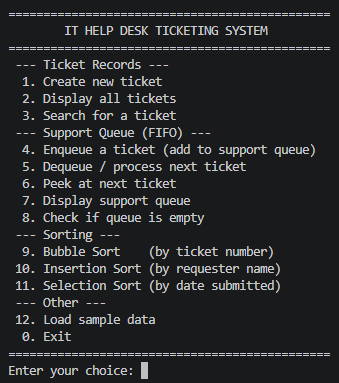
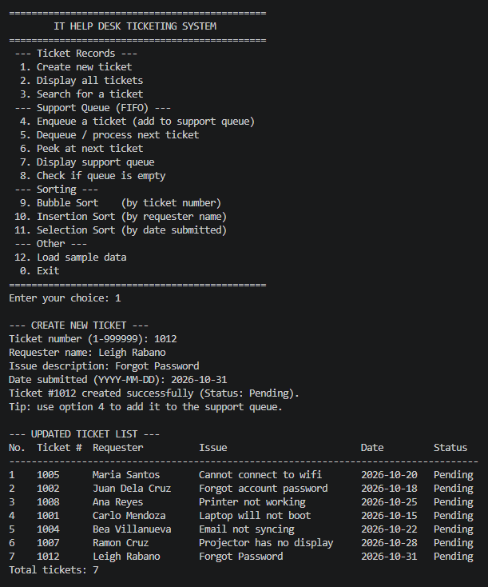
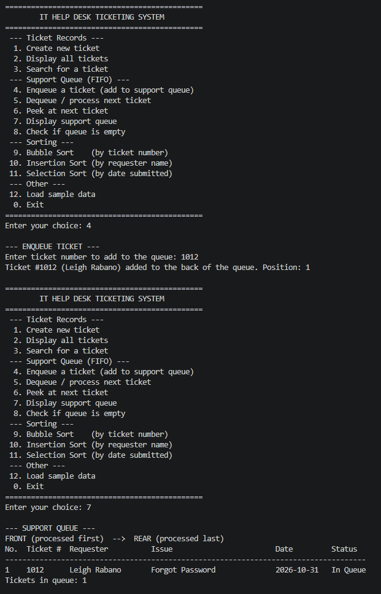
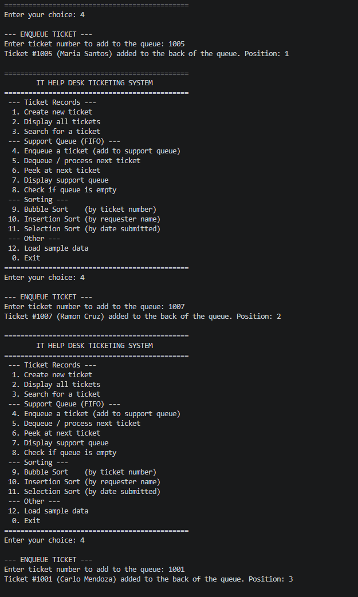
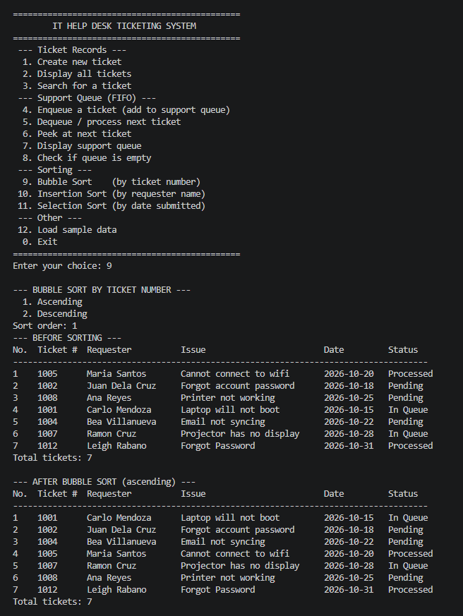
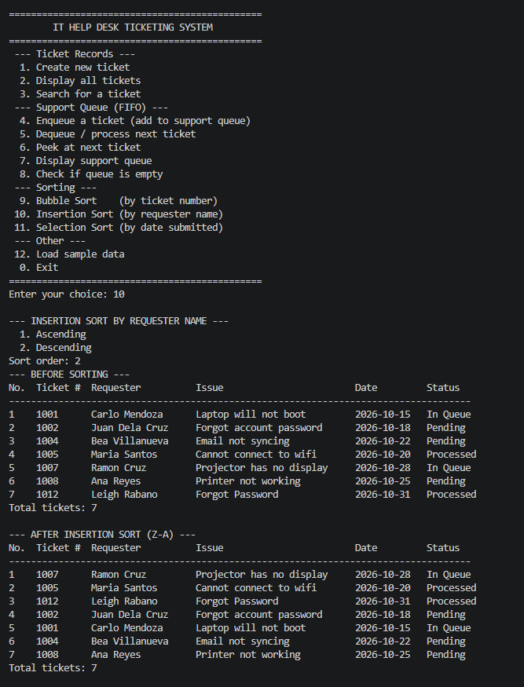
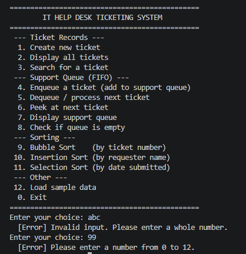

# IT Help Desk Ticketing System

A console-based Java application that manages technical support tickets using **manually implemented sorting algorithms** and a **FIFO queue**, written in a purely **procedural** style (no custom classes or OOP).

---

## Project Description

IT help desks receive many support requests from students and employees. Without organization, tickets get lost, are handled out of order, or are hard to find.

This system solves that by:

- **Storing** every ticket's details (ticket number, requester, issue, date submitted, status) in Java `ArrayList`s.
- **Queueing** tickets so they are handled fairly in **First-In, First-Out (FIFO)** order. The first ticket added to the support queue is the first one processed.
- **Sorting** ticket records by ticket number, requester name, or date submitted so staff can review them easily.
- **Searching** for a specific ticket by number or requester name.

---

## Objectives

1. Implement sorting algorithms (Bubble, Insertion, Selection) by hand to organize ticket records.
2. Apply queue operations (enqueue, dequeue, peek, display, empty check) to process tickets in FIFO order.
3. Use parallel `ArrayList`s to store and manage related ticket data with synchronized indexes.
4. Apply loops, conditionals, methods, and input validation to build a menu-driven console application.
5. Demonstrate that sorting the records never changes the order in which tickets are processed.

---

## Use Cases and Features

| # | Feature | Description |
|---|---------|-------------|
| 1 | Create new ticket | Adds a ticket (number, requester, issue, date). Status starts as `Pending`. |
| 2 | Display all tickets | Shows every ticket in a table. |
| 3 | Search for a ticket | Linear search by ticket number or by (partial) requester name. |
| 4 | Enqueue | Adds a pending ticket to the back of the support queue (status becomes `In Queue`). |
| 5 | Dequeue / process next | Removes the front ticket from the queue and marks it `Processed`. |
| 6 | Peek | Shows the next ticket without removing it. |
| 7 | Display queue | Shows the queue from front to rear. |
| 8 | Check if queue is empty | Reports whether any tickets are waiting. |
| 9 | Bubble Sort | Sorts records by **ticket number** (ascending/descending). |
| 10 | Insertion Sort | Sorts records by **requester name** (A–Z / Z–A). |
| 11 | Selection Sort | Sorts records by **date submitted** (oldest/newest first). |
| 12 | Load sample data | Loads 6 sample tickets for quick testing. |
| 0 | Exit | Ends the program. |

**Input validation:** invalid menu choices, non-numeric input, empty fields, duplicate ticket numbers, invalid dates, and non-existent tickets are all handled with clear error messages. The program does not crash.

---

## Data Structure Explanation

### ArrayLists (record storage)

Ticket records are stored in **parallel ArrayLists**. The value at index `i` in every list belongs to the **same ticket**:

```java
ArrayList<Integer> ticketNumbers;
ArrayList<String>  requesterNames;
ArrayList<String>  issues;
ArrayList<String>  datesSubmitted;   // YYYY-MM-DD
ArrayList<String>  statuses;         // Pending / In Queue / Processed
```

To keep indexes synchronized, all changes go through helper methods:

- `addRecord(...)` adds to **all five** lists at once.
- `swapRecords(i, j)` swaps the record at two positions in **all five** lists.
- `setRecord(...)` / `copyRecord(...)` overwrite or copy a record across **all five** lists.

### Queue (support workflow)

```java
Queue<Integer> supportQueue = new LinkedList<>();
```

The queue is part of the main workflow: it decides **which ticket is handled next**.

| Operation | Method used | Used in |
|-----------|-------------|---------|
| Enqueue | `supportQueue.add(ticketNumber)` | Menu option 4 |
| Dequeue | `supportQueue.poll()` | Menu option 5 |
| Peek | `supportQueue.peek()` | Menu option 6 |
| Display | loop through the queue | Menu option 7 |
| Is empty | `supportQueue.isEmpty()` | Menu options 5–8 |

**Design note:** the queue stores **ticket numbers**, not list positions. Because of this, sorting the ArrayLists never changes the order in which tickets are processed. FIFO order is always preserved.

---

## Sorting Algorithm Explanation

All three sorts are written manually. `Collections.sort()` and `Arrays.sort()` are **not** used.

| Algorithm | Sorts by | How it works | Why it suits this use case |
|-----------|----------|--------------|----------------------------|
| **Bubble Sort** | Ticket number | Repeatedly compares neighboring records and swaps them if they are out of order. Stops early if a pass makes no swaps. | Simple and easy to follow. Ticket lists are small, so its speed is fine. |
| **Insertion Sort** | Requester name | Takes one record at a time and inserts it into its correct place within the already-sorted part. | Efficient for small or nearly sorted lists, such as names added over time. |
| **Selection Sort** | Date submitted | Finds the smallest (or largest) remaining record and places it at the front. | Makes few swaps, and dates in `YYYY-MM-DD` format sort correctly as text. |

Each sort first displays the records **before** sorting and then **after** sorting.

---

## How to Run the Program

**Requirements:** Java JDK 8 or higher.

1. Clone or download this repository.
2. Open a terminal in the project folder.
3. Compile:
   ```bash
   cd src
   javac Main.java
   ```
4. Run:
   ```bash
   java Main
   ```

> Tip: choose option **12** (Load sample data) to test quickly.

---

## Screenshots of the System

> Replace each placeholder image with a screenshot taken from your own running program.

### 1. Main Menu

*The main menu showing all available options.*

### 2. Adding Records and Displaying Stored Records

*Creating a ticket and displaying all stored tickets.*

### 3. Queue Operations (Enqueue, Peek, Dequeue, Display)

*Adding tickets to the queue, peeking at the front, processing the next ticket, and displaying the queue.*

### 4. FIFO Behavior

*Tickets are processed in the same order they were enqueued, even after the records were sorted.*

### 5. Sorting Algorithm 1: Bubble Sort (by ticket number)

*Records before and after Bubble Sort.*

### 6. Sorting Algorithm 2: Insertion Sort (by requester name)

*Records before and after Insertion Sort.*

### 7. Input Validation and Error Messages

*Invalid menu choice, non-numeric input, duplicate ticket number, invalid date, and empty queue messages.*

---

## Suggested Demo Flow (for taking screenshots)

1. Run the program and screenshot the **main menu**.
2. Choose **12** (load sample data), then **2** (display records).
3. Choose **9** (Bubble Sort) and screenshot the before/after tables.
4. Choose **10** (Insertion Sort) and screenshot the before/after tables.
5. Choose **4** three times (e.g., tickets 1005, 1002, 1008), then **7** to show the queue.
6. Choose **6** (peek), then **5** three times (dequeue) to show FIFO order.
7. Try invalid inputs: `abc`, `99`, a duplicate ticket number, or the date `2026-02-30`.

---

## Project Structure

```
DSA-Java-Sorting-Queue-Capstone/
├── src/
│   └── Main.java
├── screenshots/
│   ├── main-menu.png
│   ├── add-display-records.png
│   ├── queue-operations.png
│   ├── fifo-behavior.png
│   ├── sorting-algorithm-1.png
│   ├── sorting-algorithm-2.png
│   └── input-validation.png
└── README.md
```

---

## Author

Leigh Xander Rabano
